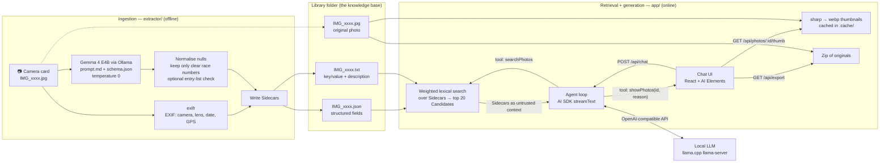
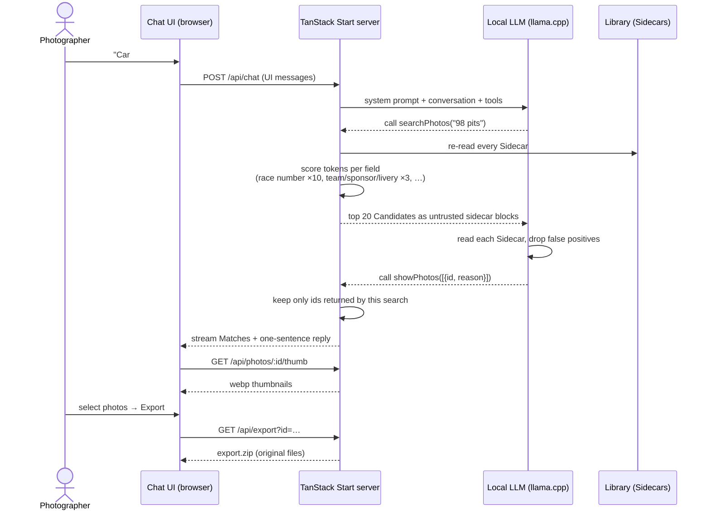

<p align="center">
  
</p>

# Fluffy Photo — race car photo metadata extractor

Built for [Hacktoberfest Hack Day Milano × Coding Bunker](https://www.mlh.com/events/hacktoberfest-hack-day-milano-x-coding-bunker) (Hacktoberfest 2026).

**Find the shot while the race is still on.** Fluffy Photo reads each photo as it comes off the camera, extracts race numbers, teams, sponsors, liveries, classes and scene context with an open-weight vision model, and writes searchable `.txt` + `.json` sidecars — so "all shots of car #98 in the pits" is a query, not a half-hour scroll.

Status: **working prototype**. Extraction works end to end on the sample photos, and a local chat web app finds photos from a natural-language request and exports them as a zip.

## The problem

During a race, photographers and photojournalists shoot thousands of frames that land on the laptop as `IMG_2843.jpg`. When the editor calls asking for shots of car #98 for the article, or a team wants photos of its car for social media *now*, finding them means scrolling through the card for precious minutes — and news value decays by the minute.

Deadlines are the whole game: a photo sent during the race makes the article; a photo sent the next day doesn't. Manual tagging between sessions is too slow, and cloud vision APIs are a non-starter trackside (expensive, unreliable connectivity, and clients' photos shouldn't leave your machine). Fluffy Photo tags every frame locally, as it's imported, so the archive is searchable the moment the chequered flag falls.

## Why it fits the Hack Day challenges

| Challenge | Why this project |
|---|---|
| **Best Use of Gemma 4** (Google DeepMind) | The entire visual pipeline runs on **Gemma 4 E4B** (Apache-2.0) via Ollama: OCR-by-vision (race numbers, sponsors, class markings), scene understanding and structured JSON extraction, in a single pass per photo. |
| **Best Open-Source AI Project** (DigitalOcean) | Open-weight model, fully local inference, open-source license (GPL-3.0-or-later), public repo. No API keys, no data leaves the machine. |
| **Most Creative Hack** | One open-weight vision model quietly turns a laptop in the media centre into a searchable race archive — no cloud, no lab, just a camera, a card and a deadline. |

## Quick start

Prerequisites: [Node.js ≥ 20](https://nodejs.org) and [Ollama](https://ollama.com).

```sh
ollama pull gemma4:e4b
cd extractor && npm install
node extract.mjs ../samples --force
```

Each photo `X.jpg` gets `X.txt` (key/value metadata + description, for BM25/vector search) and `X.json` (all extracted data). Optional: `--entries entrylist.csv` checks extracted race numbers against an entry list to reject invented digits.

Then search the photos from the web app (needs Node ≥ 22, pnpm and a local `llama-server` with tool calling, see [`app/README.md`](app/README.md)):

```sh
llama-server -hf unsloth/Qwen3.8-Flash-Next-GGUF:UD-Q4_K_XL --jinja --port 8080
cd app && pnpm install && pnpm dev   # http://localhost:3000
```

## Architecture

Fluffy Photo is a **Retrieval-Augmented Generation (RAG)** system split in two independent halves that only share a folder on disk:

- **Ingestion** (`extractor/`, offline, one pass per photo): a vision model turns every photo into structured, searchable text — the Sidecars. This is the "indexing" step of a RAG pipeline: the knowledge base is built once, as photos come off the card.
- **Retrieval + generation** (`app/`, online, per request): the chat app retrieves candidate photos by searching the Sidecars, hands them to an LLM as context, and the LLM decides which ones really match and explains why.



### Ingestion: from photo to Sidecar

Each photo goes through the extractor once ([details](#how-extraction-works)). The output is plain files next to the photo, so there is no database to run and any tool can read them:

- `X.json` — every extracted field (cars, race numbers with legibility, sponsors, livery, scene, EXIF), used for scoring and for the photo details panel;
- `X.txt` — a compact, human-readable digest of the same data, written to be fed straight to an LLM as context.

### Retrieval: how a chat request finds photos



In RAG terms:

| RAG step | In Fluffy Photo |
|---|---|
| **Index** | The extractor writes one `.json` + `.txt` Sidecar per photo. |
| **Retrieve** | `searchPhotos` scores every Sidecar against the request's keywords, with field weights (race number counts 10×, teams/sponsors/livery 3×, scene and description 1×) and returns the top 20 Candidates. Recall over precision: it is deliberately loose. |
| **Augment** | The Candidates' `.txt` Sidecars are injected into the conversation as tool output, wrapped in `<sidecar untrusted="true">` and escaped, so text read off a livery can never act as an instruction. |
| **Generate** | The LLM reranks by reading the Sidecars, calls `showPhotos` with only the real Matches and a short reason each, then writes one sentence. The server rejects any id that the search did not return, and replaces the reply with "I couldn't find any photos" when nothing was shown — so the model cannot invent photos. |

What it is **not** (yet): there are no embeddings and no vector database. Retrieval is lexical, the LLM is the semantic layer on top of it, and the Library is re-read on every search, so new Sidecars appear without a restart. This is plenty for one race card (hundreds to a few thousand photos); hybrid search with LanceDB + `nomic-embed-text` is the planned next step for larger archives (see [Roadmap](#roadmap)).

## How extraction works

For each photo the script:

1. reads EXIF (camera, lens, focal length, shutter speed, ISO, date, GPS) with `exifr`;
2. sends the image to `gemma4:e4b` with `prompt.md` + `schema.json`, `temperature: 0` and thinking disabled;
3. replaces placeholder strings such as `"null"` or `"n/a"` with real nulls;
4. keeps a race number only if the model marks it `clear` and, when `--entries` is given, it is on the entry list; otherwise it is kept as a candidate with the reason;
5. writes `photo.json` (all data) and `photo.txt` (key/value header + description, ready for full-text and vector search).

## Open-source stack

| Component | Role | License |
|---|---|---|
| [Gemma 4 E4B](https://ollama.com/library/gemma4) | Vision + structured extraction, one model does all the visual work | Apache-2.0 |
| [Ollama](https://ollama.com) | Local inference, enforces the JSON schema via the `format` parameter | MIT |
| [exifr](https://github.com/MikeKovarik/exifr) | EXIF reading | MIT |
| [Node.js](https://nodejs.org) | Tooling | MIT |
| LanceDB + `nomic-embed-text` | *Planned*: hybrid search (BM25 + vectors) over the sidecars | Apache-2.0 / MIT |

## Web app stack

The search app in [`app/`](app/) is a single full-stack TypeScript project: the same process serves the UI, the chat API and the photos.

| Layer | Technology | Role |
|---|---|---|
| Framework | [TanStack Start](https://tanstack.com/start) + [TanStack Router](https://tanstack.com/router) | Full-stack React with file-based routes, server functions and API routes (`/api/chat`, `/api/photos/:id/*`, `/api/export`) |
| Build | [Vite 8](https://vite.dev) | Dev server and production build |
| UI | [React 19](https://react.dev) | Components |
| Styling | [Tailwind CSS 4](https://tailwindcss.com) + [shadcn/ui](https://ui.shadcn.com) on [Radix UI](https://www.radix-ui.com) | Design system and accessible primitives (dialog, checkbox, tooltip, …) |
| Chat components | [AI Elements](https://ai-sdk.dev/elements) + [Streamdown](https://streamdown.ai) | Conversation, prompt input, reasoning and streaming Markdown |
| LLM orchestration | [Vercel AI SDK](https://ai-sdk.dev) (`ai`, `@ai-sdk/react`, `@ai-sdk/openai-compatible`) | `streamText` agent loop with tools, `useChat` streaming on the client |
| Local LLM | [llama.cpp](https://github.com/ggml-org/llama.cpp) `llama-server` (default: Qwen GGUF) | OpenAI-compatible endpoint with tool calling; any compatible server works via `LLM_BASE_URL` |
| Validation | [Zod 4](https://zod.dev) | Tool input schemas and tolerant Sidecar parsing |
| Images | [sharp](https://sharp.pixelplumbing.com) | On-demand webp thumbnails and previews, cached on disk |
| Export | [archiver](https://github.com/archiverjs/node-archiver) | Streams the selected original photos as a zip |
| Icons / motion | [Lucide](https://lucide.dev), [Motion](https://motion.dev) | Icons and animations |
| Testing | [Vitest](https://vitest.dev) + [Testing Library](https://testing-library.com) + happy-dom | Unit and component tests |
| Lint / format | [Biome](https://biomejs.dev) via [Ultracite](https://www.ultracite.ai) | Linting and formatting |
| Tooling | TypeScript 6, pnpm, Node ≥ 22 | |

Configuration (Library folder, LLM endpoint and model) is through env vars, documented in [`app/README.md`](app/README.md).

Decisions and alternatives considered (Apple Vision, MLX, dedicated OCR/logo detectors) are documented with sources in [`docs/research/race-car-photo-metadata-extraction.md`](docs/research/race-car-photo-metadata-extraction.md).

## Repository layout

| Path | What it is |
|---|---|
| `docs/research/race-car-photo-metadata-extraction.md` | Research notes: OCR, small vision models, logo detection, embeddings, vector DBs, EXIF/XMP, pitfalls |
| `extractor/` | The extraction script ([usage](extractor/README.md)) |
| `extractor/extract.mjs` | Reads EXIF, asks Gemma for structured JSON, checks race numbers, writes `.txt` + `.json` sidecars |
| `extractor/prompt.md` | System prompt sent to the model |
| `extractor/schema.json` | JSON schema enforced through Ollama's `format` parameter |
| `app/` | Chat web app to search the Library and export photos ([setup](app/README.md)) |
| `app/src/server/search.ts` | Weighted lexical retrieval over the Sidecars |
| `app/src/server/chat.ts` | System prompt, `searchPhotos` / `showPhotos` tools and the agent loop |
| `samples/` | Sample photos with their generated Sidecars |

## Known limitations

- **Team names are unreliable**: the model often picks a manufacturer brand or a sponsor.
- **Series and class markings still leak into sponsors** at times.
- **No second opinion on race numbers**: without OCR, the only guards against invented numbers are the `clear` legibility flag and the optional entry list.
- **Small text**: Gemma 4 supports up to 1120 visual tokens per image, but Ollama's API documents no option to choose the budget, so fine details may be lost on wide shots.
- **Only JPEG, PNG and WebP**: RAW and HEIC files must be converted first.

## Roadmap

Hack Day (2026-10-17, Milan):

1. Label 50–100 real photos by hand and measure accuracy per field.
2. ~~Search over the sidecars~~ — done with lexical retrieval + LLM reranking in the web app; next, a LanceDB hybrid index (BM25 + vectors) for larger archives.
3. Iterate on the prompt/schema based on the measurements.

After the event:

4. Only if the measurements show a gap: add an OCR cross-check for numbers (PaddleOCR/EasyOCR) or logo matching (SigLIP 2), as described in the research notes.

## Future evolutions

- **Beyond motorsport**: the same pipeline generalises to any sport with numbered athletes and sponsor-rich visuals — football, cycling, basketball, skiing. The prompt and schema are the only things to adapt per sport.
- **iPad and MacBook support**: a trackside workflow that runs where photographers actually work — from the laptop in the media centre to the iPad in the stands.
- **Remote archive management**: centralised, searchable archives shared between photographers, editorial desks and agencies, so an editorial desk can search a photographer's card without waiting for the upload.

## Contributing

Issues and PRs welcome — this repo is also a playground for Hacktoberfest contributions. See [open issues](../../issues) for ideas (search backend, prompt improvements, accuracy benchmarks, more sample photos).

## Team

Built at Hacktoberfest Hack Day Milano × Coding Bunker, 2026-10-17.

- [ludusrusso](https://github.com/ludusrusso)
- [elena563](https://github.com/elena563)
- [bombo82](https://github.com/bombo82)
- [crakdelpol](https://github.com/crakdelpol)

## License

[GNU GPL v3 or later](LICENSE) (GPL-3.0-or-later). Sample photos in `samples/` are from Wikimedia Commons and remain under their own licences (CC BY-SA / CC0 / CC BY).

